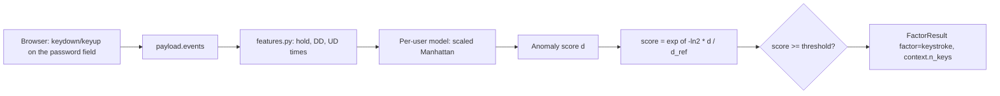

# Keystroke rhythm factor: design (M3)

| | |
|---|---|
| **Factor name** | `keystroke` (category: something you **do**) |
| **Owner** | M3 (Nurmuhammad) |
| **Status** | Week 2 design. Feature extraction ([`features.py`](features.py)) and CMU baseline ([`experiments/`](experiments/README.md)) done |
| **Related** | [`../password/DESIGN.md`](../password/DESIGN.md), [`docs/interface.md`](../../../../docs/interface.md) |

## 1. Idea

While the user types their password, the browser records when each key goes down and up. The *rhythm*
(how long keys are held, the gaps between them) is characteristic of a person. Each user has a one-class
model trained only on their own samples; at login the new sample is compared with that model.

Even an attacker who **knows the password** (`imposter_typing`) should be rejected if they type it
differently.

## 2. Capture and features



- **Browser (week 7):** listen to `keydown` / `keyup` on the password input; record `performance.now()`
  in milliseconds. Pasting or autofill gives no events → the factor cannot run (`bad_payload`).
- **Features ([`features.py`](features.py), done):** `extract_features(events)` pairs every key-down
  with its key-up and returns, for keystrokes k0…kn, the vector
  `H.k0, DD.k0.k1, UD.k0.k1, H.k1, …, H.kn` in **seconds**, the same order and unit as the CMU dataset.
  n keystrokes → 3n − 2 features (11 → 31).
- **Rules** (all unit-tested in `backend/tests/factors/keystroke/test_features.py`):
  modifier keys (Shift, …) are skipped, capital letters count as one keystroke (like CMU's `Shift.r`);
  auto-repeat and stray key-ups are ignored; an editing key (Backspace, arrows, …) or a key that is never
  released makes the sample invalid (`FeatureError` → `bad_payload`, the UI asks the user to retype).
- **Enter:** if the user submits with Enter, it is a keystroke too (CMU includes `Return`). The browser must
  wait for the Enter key-up before sending. Simpler alternative: never include Enter; the vector is then
  3 features shorter, which is fine as long as enrollment and login do the same.

## 3. Enrollment

- **When:** right after the password is set (registration or password change). A new password
  invalidates the keystroke model (the vector length and rhythm depend on the password).
- **How many samples:** **10** typings of the password (about one minute). The CMU experiment shows the
  trade-off (Manhattan, same test set):

  | Training samples | 10 | 20 | 50 | 200 |
  |---|---|---|---|---|
  | EER | 0.229 | 0.197 | 0.154 | 0.096 |

  More than 10–15 at enrollment is too tiring for users (SUS target ≥ 70), so instead:
- **Model update (adaptation):** after a login that was **fully authenticated** and in which at least one
  factor *other than* password and keystroke passed, the keystroke sample is added to the user's samples
  (keep the most recent 50), and the model is refit. Requiring another factor stops an attacker who
  knows the password from slowly "teaching" the model their own rhythm (template poisoning). During the
  user study, only add samples from rows with `is_genuine=true`.
- **Enrollment done** = at least 10 valid samples of the same length → `is_enrolled()` returns `True`.
- **Stored per user:** the samples' timing vectors (needed for refitting) and the fitted model
  parameters, in PostgreSQL. **Never the characters**. This is behavioural biometric data: personal data,
  pseudonymised user IDs, deleted after the project, never in git.

## 4. Model, score and threshold

**Model v1: scaled Manhattan** (Killourhy & Maxion's best simple detector).

- Fit: per-feature mean `μ` and mean absolute deviation `a` of the user's samples.
- Anomaly score: `d(x) = Σ |x_i − μ_i| / a_i` (higher = less like the user).
- Why this one first: no hyperparameters, trains instantly, the "model" is two vectors that are easy to
  explain at the defense. With 10–20 samples it is within about 0.02 EER of One-Class SVM (0.229 vs
  0.207 at 10, 0.197 vs 0.184 at 20). One-Class SVM and Isolation Forest (CLAUDE.md) are kept in the
  experiment and compared again on our volunteer data in weeks 12–15; if One-Class SVM is still better
  there, we switch (only the fit/score functions change). Isolation Forest is best with 200 samples
  (EER 0.085) but worst with 10.

**Score mapping (anomaly → `FactorResult.score` in 0–1, higher = more genuine):**

`score = exp(−ln 2 · d / d_ref)`, where `d_ref` is the **median leave-one-out anomaly score of the user's
own samples** (fit on all samples but one, score the left-out one, repeat).

- A login typed as typically as the user's median sample gets `score = 0.5`; a perfect match gets `1.0`;
  twice as unusual as the median gets `0.25`.
- Dividing by `d_ref` puts every user on the same scale (some people type very consistently, some do
  not). That lets us use **one global threshold** and lets M1 compute a single pooled EER from
  `FactorResult.score` without knowing anything about each user's model.

**Threshold:** start with `score ≥ 0.25` (i.e. `d ≤ 2·d_ref`). The final value is chosen with M1 in
weeks 12–15 on CMU + volunteer data, at the EER point or at a target FRR (keystroke should not annoy
genuine users; it is one factor among several).

## 5. Relation to the password factor (answer to open question 6)

Keystroke rhythm is captured **while the password is typed**, so:

1. **Keystroke can only be selected together with `password`.** There is no separate typing screen
   (typing a second phrase would add time and the CMU data is for passwords). Proposal for the engine:
   `keystroke` has a dependency `requires: password`; if the engine picks keystroke, password is on the
   same screen.
2. **One screen, two FactorResults.** The password screen sends both the password and the key events.
   The core calls `password.verify()` and then `keystroke.verify()` and logs **two attempt rows**, so
   M1 can measure them separately.
3. **Keystroke is only evaluated if the password is correct.** If the password is wrong, the rhythm is
   of a different string (different length) and means nothing; no keystroke row is logged for that
   attempt. This also matches the `imposter_typing` attack: the imposter knows the correct password,
   and keystroke alone decides.
4. **Category diversity:** password (know) + keystroke (do) are different categories, but they share one
   secret and one screen. Suggest the engine treats them as diverse but the team discusses whether k=2
   with {password, keystroke} is enough for **high** risk.

## 6. Availability

- Phones: on-screen keyboards often report `key = "Unidentified"` and give unreliable key-down/up
  times. **v1: `is_available()` returns `False` on `device_type = "phone"`.** In week 7 we test the
  mobile browser; if timings are usable we add a separate phone model (laptop and phone rhythms differ).
- Light does not matter, so for the trust table `laptop_normal` and `laptop_dim` are expected to be the
  same (M1 can still measure both).
- Pasting / password managers: no events → `bad_payload`; the user is asked to type it.

## 7. Plug-in behaviour (from week 3, against `base.py`)

| Method | Behaviour |
|---|---|
| `is_enrolled(user_id)` | user has a model with ≥ 10 samples (database read, see open question 2) |
| `is_available(ctx)` | `ctx.device_type == "laptop"` (v1) |
| `start(user_id, ctx)` | returns `{"mode": "with_password", "expected_keys": <n>}` |
| `verify(user_id, payload, ctx)` | `extract_features(payload["events"], expected_keys=n)` → model → score → `FactorResult` |
| mock | accepts if `payload["mock_accept"]` is true, score 0.9 / 0.1 |

Error codes used: `not_enrolled` (no model), `unavailable` (phone in v1), `bad_payload` (malformed events,
wrong number of keys, editing keys, no events), `internal`.

`FactorResult` example:

```json
{ "factor": "keystroke", "accepted": true, "score": 0.62, "duration_ms": 3100,
  "context": { "n_keys": 11 }, "error": null }
```

`duration_ms` is shared with the password (same screen); report the same value in both rows and
the Trust Lab must not add them up for login time.

## 8. Attacks

| `attack_type` | How | Expected |
|---|---|---|
| `imposter_typing` | Another volunteer is told the victim's password and types it (several attempts, also after watching the victim type) | rejected in most cases; attack success measured per condition (target set with M1; ≤ 5% is unlikely for keystroke alone, which lowers its trust value) |
| replay of a captured `events` payload | needs a man-in-the-middle; prevented by HTTPS. Optional: reject a vector identical to a stored sample | out of scope for measurement |

## 9. Answers to interface open questions (M3)

**Q2: sync or async `is_enrolled()`?** All three M3 factors keep their enrollment in PostgreSQL
(password hash, WebAuthn credentials, keystroke model), so `is_enrolled()` needs a database read.
→ Make it **`async def is_enrolled(...)`**. (Alternative: the core loads one "enrollments" row per user
and passes it in, which keeps the method sync but makes the core know about every factor's storage;
we prefer async.)

**Q3: `enroll_start` / `enroll_finish` on the same class?** Yes. Two notes:
- Keystroke needs **several samples** (10), and passkey registration needs the challenge kept between
  the two calls (Redis). Proposal: `enroll_finish` returns a dict instead of `bool`:
  `{"done": false, "remaining": 7}` / `{"done": true}`, so the UI can loop without a special case.
- Password enrollment is "set password" and can fail for a reason the user must see (`"leaked"`,
  `"too_short"`). The same dict can carry it: `{"done": false, "reason": "leaked"}`.

**Q6: keystroke with or without password?** See section 5: only together with password, same screen,
two FactorResults, keystroke evaluated only when the password is correct.

## 10. Proposals for interface v0.2

1. `is_enrolled` becomes `async` (Q2).
2. `enroll_finish` returns `{"done": bool, "remaining"?: int, "reason"?: str}` instead of `bool` (Q3).
3. Factor dependency: `keystroke` requires `password` in the same selection, and the core sends one
   password-screen submission to both factors (Q6). Suggested combined verify request:
   `{ "factor": "password", "payload": { "password": "...", "keystroke": { "events": [...] } } }`;
   the core passes `payload["keystroke"]` to `keystroke.verify()`.
4. **Hide the characters in the keystroke payload.** The `events[].key` value only has to match a
   key-down with its key-up. The browser should send an opaque label per physical key
   (e.g. `"k1"`, `"k2"` assigned by `event.code` within one sample) and the real name only for
   `Shift`, `Enter`, `Backspace` and other special keys. `features.py` already works with any labels.
   Then the password is not sent twice and the stored data never contains it.
5. `keystroke.start()` returns `{"mode": "with_password", "expected_keys": <int>}`.
6. Keystroke `context` keys: `n_keys` (already in v0.1). Nothing else for now.
