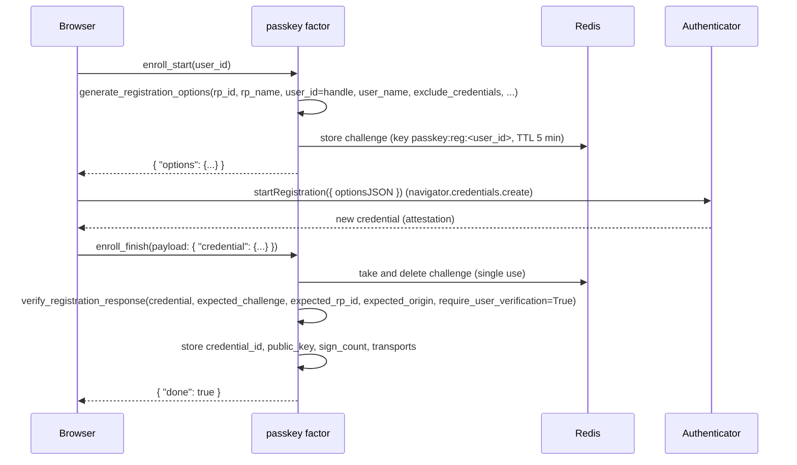
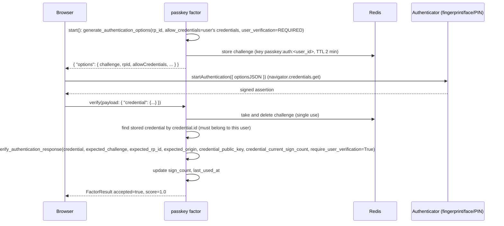

# Passkey factor: design (M3)

| | |
|---|---|
| **Factor name** | `passkey` (category: something you **have**: the device holding the private key, unlocked with fingerprint / face / PIN) |
| **Owner** | M3 (Nurmuhammad) |
| **Status** | Week 5: **registration implemented** (`factor.py`, `storage.py`, `challenges.py`, `config.py`), phone HTTPS set-up in [`PHONE_HTTPS.md`](PHONE_HTTPS.md). Login week 6 |
| **Related** | [`docs/interface.md`](../../../../docs/interface.md) |

## 1. How passkeys (WebAuthn) work, in short

- At **registration**, the user's device (the *authenticator*: Windows Hello, Touch ID, Android, a
  security key) creates a new key pair **for our site only**. The private key never leaves the device;
  we store the **public key** and a **credential ID**.
- At **login**, we send a random **challenge**; the device asks the user for fingerprint / face / PIN
  (*user verification*) and signs the challenge together with our **origin**. We check the signature
  with the stored public key.
- The browser binds every credential to the **RP ID** (our domain). A fake site on another domain cannot
  ask for a signature for our domain, which is why phishing should fail **by design**.

Libraries (no custom crypto): backend **`webauthn`** (py_webauthn, Duo Labs, **3.0.1**); browser
**`@simplewebauthn/browser`** for the React screens (the week 5 test page `frontend/public/passkey-demo.html`
uses the browser's own `navigator.credentials.create()` with the same JSON format).

## 2. Configuration

| Setting | Development | Phone tests |
|---|---|---|
| `WEBAUTHN_RP_ID` | `localhost` | the ngrok host, e.g. `trustauth-demo.ngrok-free.app` |
| `WEBAUTHN_ORIGIN` | `http://localhost:5173` (the Vite page the browser shows; the API is proxied) | `https://trustauth-demo.ngrok-free.app` |
| `WEBAUTHN_RP_NAME` | `TrustAuth` | `TrustAuth` |

- WebAuthn only works in a **secure context**: HTTPS, or `localhost`. Phones cannot reach our
  `localhost`, so phone tests use an HTTPS tunnel (ngrok) (week 5).
- The RP ID must **exactly** match the domain the browser shows. A credential registered under one RP ID
  does not work under another, so we use **one fixed ngrok domain** (ngrok gives one free static domain);
  otherwise every volunteer would have to re-register their passkey each time the URL changes.

## 3. Registration (enrollment)



**Enrollment reasons (week 5, `EnrollResult.reason`):** `cancelled` (browser prompt closed: `client_error`),
`expired` (no `enroll_start`, older than 5 min, or the challenge was already used), `rejected` (py_webauthn
refused it: other challenge, other origin or RP ID, no user verification, unreadable data),
`already_registered` (this credential ID belongs to an account already), `bad_payload` (no `credential`
object).

Option choices:

| Option | Value | Why |
|---|---|---|
| `user_id` (user handle) | random 32 bytes, stored per user | Must not contain the username or e-mail (it is stored on the device) |
| `user_name` / `user_display_name` | the TrustAuth username | Shown in the device's passkey picker |
| `authenticator_selection.user_verification` | `required` | We want fingerprint / face / PIN, not just "device present" |
| `authenticator_selection.resident_key` | `preferred` | Makes it a real passkey (discoverable), but security keys without storage still work |
| `attestation` | `none` | We do not need to know the device model; avoids extra privacy data |
| `exclude_credentials` | the user's existing credentials | The same device is not registered twice |

## 4. Login (verification)



What `verify_authentication_response` checks for us: the signature with the stored public key; that the
challenge is ours; that the **origin** and **RP ID** match; that the user-verified flag is set; and the
**sign count** (if the device reports a counter and the new value is not larger than the stored one, the
key may have been cloned → rejected). Many synced passkeys (iCloud, Google) always report 0; then the
counter check is skipped, which is normal.

The challenge key is per user in the design above. When `base.py` exists, we will key it by `login_id`
if the core passes it, so two parallel logins of the same user do not overwrite each other's challenge.

## 5. Stored data

Table `webauthn_credentials`:

| Column | Type | Notes |
|---|---|---|
| `credential_id` | bytea, PK | from the authenticator |
| `user_id` | text, FK | pseudonymised user ID |
| `user_handle` | bytea | the random handle sent at registration (same for all credentials of a user) |
| `public_key` | bytea | COSE public key |
| `sign_count` | int | last seen counter |
| `transports` | jsonb | e.g. `["internal", "hybrid"]`, used in `allowCredentials` |
| `backed_up` | bool | synced passkey or device-bound (useful for the report) |
| `created_at`, `last_used_at` | timestamptz | |

No secret is stored: the public key is useless to an attacker.

## 6. Plug-in behaviour (from week 3, against `base.py`)

| Method | Behaviour |
|---|---|
| `is_enrolled(user_id)` | user has ≥ 1 row in `webauthn_credentials` (database read → `async`) |
| `is_available(ctx)` | `ctx.webauthn_supported` (proposed LoginContext field in v0.1) |
| `start(user_id, ctx)` | authentication options as above → `{"options": {...}}` |
| `verify(user_id, payload, ctx)` | as above → `FactorResult` |
| `enroll_start` / `enroll_finish` | registration options / verify and store |
| mock | accepts if `payload["mock_accept"]` is true |

**Payloads:**

```json
// start() returns (options in the WebAuthn JSON format, from webauthn.options_to_json)
{ "options": { "challenge": "base64url...", "rpId": "localhost", "timeout": 60000,
               "allowCredentials": [{ "type": "public-key", "id": "base64url...", "transports": ["internal"] }],
               "userVerification": "required" } }
// verify() payload from the browser (the object returned by startAuthentication)
{ "credential": { "id": "...", "rawId": "...", "type": "public-key",
                  "response": { "clientDataJSON": "...", "authenticatorData": "...", "signature": "...", "userHandle": "..." } } }
// or, if the browser prompt failed:
{ "client_error": "NotAllowedError" }
// FactorResult
{ "factor": "passkey", "accepted": true, "score": 1.0, "duration_ms": 3500,
  "context": { "user_verified": true }, "error": null }
```

**Error mapping:**

| Situation | `accepted` | `error` |
|---|---|---|
| Signature, origin, RP ID or challenge check fails | false | `null` (the factor ran, the attempt failed) |
| Browser `NotAllowedError` (user closed the prompt, or it timed out in the browser) | false | `cancelled` |
| Our stored challenge expired (TTL) | false | `timeout` |
| Credential ID not registered for this user | false | `null` |
| No credentials at all | false | `not_enrolled` |
| `webauthn_supported` is false | (not selected) | `unavailable` if called anyway |
| Malformed `credential` object | false | `bad_payload` |

The browser reports `NotAllowedError` both for "user cancelled" and "browser timeout" and does not let us
tell them apart (on purpose, for privacy), so both become `cancelled`.

## 7. Attacks

| `attack_type` | How (local system only) | Expected |
|---|---|---|
| `passkey_phishing` | Serve a copy of the login page on a different origin (e.g. `http://127.0.0.1:5174`, a second ngrok domain), relay the challenge from the real backend, ask the victim to use their passkey | The browser refuses to use our credential for a different RP ID, or, if the attacker sets a matching `rpId`, the signed `origin` does not match → verification fails. **Expected success 0%.** Logged as `is_genuine=false, attack_type="passkey_phishing"` |

Out of scope: malware on the user's device, stolen unlocked phone (the factor relies on the device's
own fingerprint/face/PIN check).

## 8. Proposals for interface v0.2

1. Passkey `context` keys: `user_verified` (bool, always `true` when accepted with our settings).
   Optional: `backed_up` (bool), to compare synced vs device-bound passkeys in the results.
2. Browser-side failures are sent as `{"client_error": "<DOMException name>"}` in the verify payload
   and mapped to `cancelled` / `bad_payload`. (Phone approval and face could use the same convention,
   e.g. camera permission denied → `unavailable`.)
3. `start()` / `verify()` would benefit from knowing the `login_id` (challenge key, see §4). Proposal:
   add `login_id` to `LoginContext`, or as an extra argument.
4. `enroll_finish` returns `{"done": bool}` (same proposal as in keystroke DESIGN §10).
