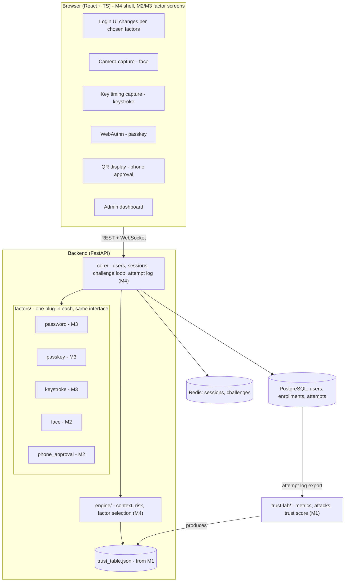
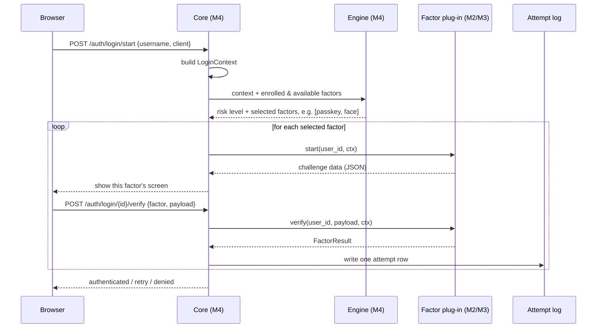
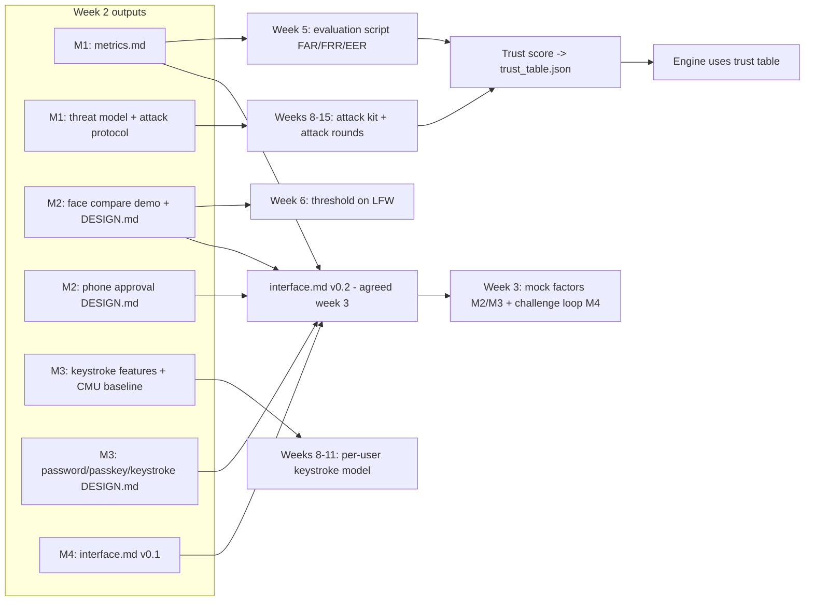
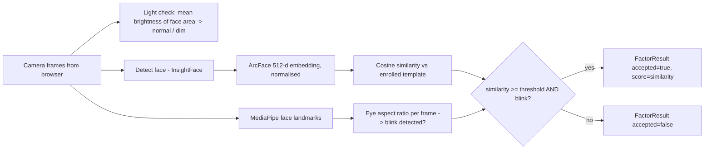
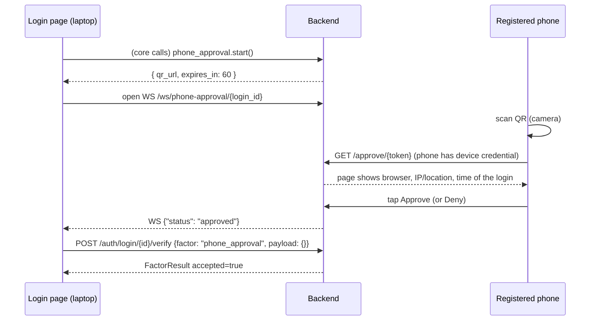
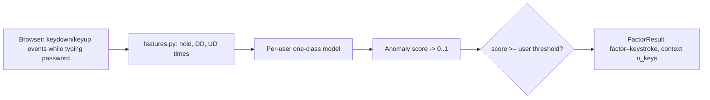
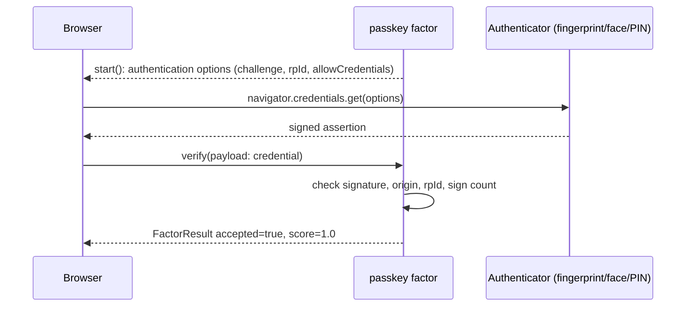
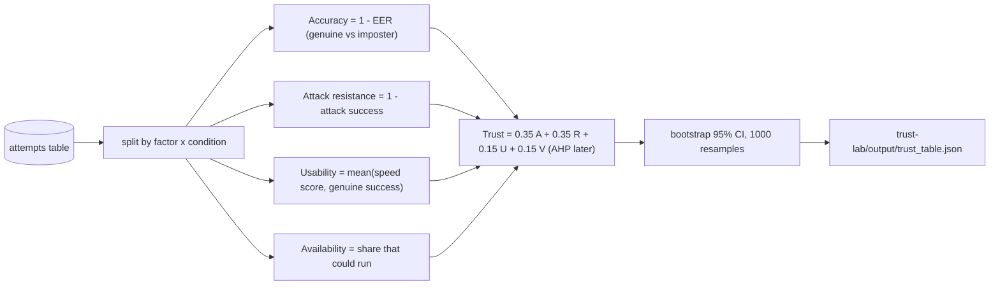

# TrustAuth — Team Plan and Week 2 Catch-u

| | |
|---|---|
| **For** | M1 Doniyor, M2 Sevinch, M3 Nurmuhammad (and the AI assistants they use) |
| **Written by** | M4 (Alisher) |
| **Status** | Project week 2. Repo, Docker skeleton and interface draft are on `main`. M1–M3 have done research only. |
| **Goal** | Finish the week 1 + week 2 tasks **before the week 3 meeting**, in a form that plugs into the platform |

Read together with:
- [`CLAUDE.md`](../CLAUDE.md): project scope, rules and full timeline
- [`docs/interface.md`](interface.md): the contract between modules (draft v0.1, agree week 3, frozen end of week 4)

---

## 0. How to use this document with an AI assistant

If you use **Claude Code** in this repo, it reads `CLAUDE.md` automatically. Start your session with:

> I am **M2 (Anvarova Sevinch)**, not M4. Read `docs/interface.md` and `docs/team-plan.md`.
> I am working on my week 2 tasks from section 4.2 of team-plan.md. Stay inside my folders.

If you use **another AI** (ChatGPT, Gemini, …), paste these three files at the start of the chat:
`CLAUDE.md`, `docs/interface.md`, `docs/team-plan.md`, then the same sentence as above.

**Rules your AI must follow (copy these into the prompt if it forgets them):**

1. Work only in my folders (see section 2). Do not edit `backend/app/core/`, `backend/app/engine/`,
   `frontend/`, `docker-compose.yml` or other members' folders.
2. Use the exact names from `docs/interface.md`: factor names (`face`, `phone_approval`, …), condition keys
   (`laptop_normal`, `phone_dim`, …), error codes (`not_enrolled`, `timeout`, …), attack type codes (section 5).
3. If I need something that is not in the interface, write it as a **proposal** in my DESIGN.md (do not
   change `docs/interface.md` directly; M4 collects proposals into v0.2).
4. Python 3.11. Use the libraries listed in `CLAUDE.md` section 10. No custom crypto, no biometric
   models from scratch.
5. Never commit datasets, face images, embeddings, keystroke recordings, `.env` or keys. Put data in
   `datasets/` or `data/` (git-ignored).
6. Explain every piece of code: I must be able to defend each line at the defense.
7. Work on a branch `m<N>-<task>`, small commits, then open a PR to `main`.

---

## 1. The big picture (what you are building into)

### 1.1 System architecture



### 1.2 One login (the "challenge loop")



**What this means for you:** your factor is a box that gets `start()` and `verify()` calls and returns a
`FactorResult`. It never talks to the engine and never decides the login outcome. M1 analyses the
attempt rows that your `FactorResult`s become.

### 1.3 How week 2 outputs feed the rest of the project



---

## 2. Folders: who writes where

```
trustauth/
├── trust-lab/                               M1 only
│   ├── README.md
│   ├── requirements.txt
│   ├── docs/        metrics.md, threat-model.md, attack-protocol.md
│   ├── src/trustlab/   python code (metrics.py, ...)
│   ├── notebooks/
│   ├── tests/
│   └── output/      trust_table.json (later)
├── backend/app/factors/
│   ├── face/                                M2 only
│   │   ├── DESIGN.md
│   │   └── experiments/   compare.py, webcam_demo.py, requirements.txt, README.md
│   ├── phone_approval/                      M2 only
│   │   └── DESIGN.md
│   ├── password/                            M3 only
│   │   └── DESIGN.md
│   ├── passkey/                             M3 only
│   │   └── DESIGN.md
│   └── keystroke/                           M3 only
│       ├── DESIGN.md
│       ├── features.py           pure function: key events -> feature vector
│       └── experiments/   baseline_cmu.py, requirements.txt, README.md
├── backend/tests/factors/<your factor>/     your tests (M2/M3)
└── datasets/                                git-ignored: LFW, CMU, any local data
```

**Why `experiments/`:** week 2 work is prototypes with heavy libraries (InsightFace, scikit-learn) that
are not in the backend Docker image yet. Keep them in `experiments/` with their own `requirements.txt` and
run them in a local Python 3.11 virtual environment. Do **not** add them to `backend/requirements.txt`
yet; that happens when the real factor is integrated (week 4 onward), coordinated with M4.

---

## 3. Everyone, first (about 30 minutes)

1. Install Git, Docker Desktop and Python **3.11**.
2. Clone and set up:
   ```sh
   git clone https://github.com/alisher876/trustauth.git
   cd trustauth
   cp scripts/pre-push .git/hooks/pre-push && chmod +x .git/hooks/pre-push   # Git Bash on Windows
   cp .env.example .env                                                       # set POSTGRES_PASSWORD
   docker compose up --build
   ```
   Check that http://localhost:5173 shows **"Backend connected"**.
3. Read `docs/interface.md` fully. Each of you answers the open questions marked for you in section 4.
4. Create your branch from fresh `main`: `git switch main && git pull && git switch -c m2-face-prototype`.
5. Local Python environment for experiments (not Docker):
   ```sh
   python -m venv .venv
   .venv\Scripts\activate          # Windows (PowerShell);  source .venv/bin/activate on macOS/Linux
   pip install -r <your experiments>/requirements.txt
   ```

---

## 4. Week 2 tasks per member

Weeks 1 and 2 are combined because week 1 is not done yet. Each task has a file, a "done when" check,
and a branch. Tick the boxes in your PR description.

### 4.1 M1 — Doniyor — Trust Measurement Lab

**Branch:** `m1-lab-foundations` **Folder:** `trust-lab/`

| # | Task (origin) | Output file | Done when |
|---|---|---|---|
| 1 | Folder setup | `trust-lab/README.md`, `requirements.txt` (pandas, numpy, scipy, matplotlib, scikit-learn, jupyter, pytest) | `pip install -r` works; README says what each subfolder is for |
| 2 | Metrics list (wk 1) | `trust-lab/docs/metrics.md` | Every metric in the table below has a definition, formula, which **attempt log columns** (interface §8) it uses, and its target from CLAUDE.md §9 |
| 3 | First attack list (wk 1) + threat model (wk 2) | `trust-lab/docs/threat-model.md` | Assets, attacker types, per-factor threats, in/out of scope; every attack has an `attack_type` code from section 5 |
| 4 | Attack-test protocol (wk 2) | `trust-lab/docs/attack-protocol.md` | One card per attack (template below) + the genuine/imposter protocol |
| 5 | Interface review | comments in PR / meeting | Answers to open questions **1** and **5**; confirms §7 trust table and §8 log columns are enough to compute every metric |
| 6 | *Stretch:* metric functions | `trust-lab/src/trustlab/metrics.py` + `tests/test_metrics.py` | `far()`, `frr()`, `eer()` work on synthetic scores and are unit-tested (this gives week 5 a head start) |

**Metrics that `metrics.md` must cover:**

| Metric | Formula / definition | Computed from |
|---|---|---|
| FAR (false accept rate) | imposter attempts accepted / imposter attempts | `is_genuine=false`, `attack_type=null`, `accepted` |
| FRR (false reject rate) | genuine attempts rejected / genuine attempts (only rows with `error=null`) | `is_genuine=true`, `accepted`, `error` |
| EER | the threshold where FAR = FRR; report the rate at that point | `score` of genuine vs imposter attempts |
| DET curve | FRR vs FAR over all thresholds | `score` |
| Attack success rate | attack attempts accepted / attack attempts, per `attack_type` | `attack_type`, `accepted` |
| Genuine success rate | genuine attempts accepted / genuine attempts | `is_genuine=true`, `accepted` |
| Time to authenticate | median `duration_ms` per factor; per login: sum over the login | `duration_ms`, `login_id` |
| Availability | attempts with `error` not in {`unavailable`, `internal`, …} / all attempts | `error` |
| Trust sub-scores and trust | CLAUDE.md §6 formulas, weights 0.35/0.35/0.15/0.15, AHP later | all of the above |
| 95% CI | bootstrap, 1000 resamples | per factor × condition |
| Predictability | Shannon entropy of selected factor sequences | `selected_factors`, `selector` |
| SUS | standard 10-question System Usability Scale, 0–100 | questionnaire |
| Statistical test | Wilcoxon signed-rank, p < 0.05 (adaptive vs others) | per-user paired results |

Note: "imposter" (a different real person trying, e.g. wrong face or someone else typing your password)
and "attack" (a crafted attack like a printed photo) are different rows: imposters feed **accuracy**
(EER), attacks feed **attack resistance**. Keep this distinction in all three documents.

**Attack card template (`attack-protocol.md`):**

```markdown
### <attack_type code>, e.g. printed_photo
- Factor: face
- Attacker capability: has a printed photo of the victim's face, physical access to a laptop
- Setup: A4 colour print, 300 dpi, held 40 cm from the camera
- Conditions: laptop_normal, laptop_dim, phone_normal, phone_dim
- Trials: 20 per condition per victim (minimum)
- Success = the factor returns accepted=true
- Logged as: is_genuine=false, attack_type="printed_photo"
- Expected result / target: success ≤ 5%
- Safety: only against our local system
```

---

### 4.2 M2 — Sevinch — Face and Phone Approval

**Branch:** `m2-face-prototype` **Folders:** `backend/app/factors/face/`, `backend/app/factors/phone_approval/`

| # | Task (origin) | Output file | Done when |
|---|---|---|---|
| 1 | Install InsightFace + MediaPipe (wk 1) | `face/experiments/requirements.txt`, `face/experiments/README.md` | Fresh venv + `pip install -r` works; README lists Windows notes (InsightFace may need "Microsoft C++ Build Tools") |
| 2 | Face-comparison demo (wk 1) | `face/experiments/compare.py` | `python compare.py a.jpg b.jpg` prints cosine similarity; same person clearly higher than different people (try 3+ pairs) |
| 3 | *Nice to have:* webcam demo | `face/experiments/webcam_demo.py` | Shows live similarity to an enrolled photo + eye aspect ratio (EAR) value |
| 4 | Enrollment/verification + threshold design (wk 2) | `face/DESIGN.md` | Covers every heading in the outline below |
| 5 | Phone approval design (wk 2, early) | `phone_approval/DESIGN.md` | Sequence diagram + token rules + payload shapes + attack notes |
| 6 | Interface review | PR / meeting | Answers open question **7**; confirms the face `context` keys (`light`, `liveness_passed`) |

**Libraries (pin exact versions in `requirements.txt`):** `insightface`, `onnxruntime` (CPU),
`opencv-python`, `mediapipe`, `numpy`.

**Face pipeline to prototype and describe:**



Key facts for the prototype:
- `FaceAnalysis(name="buffalo_l")`, `app.prepare(ctx_id=-1)` for CPU; `face.normed_embedding` is already
  normalised, so cosine similarity = dot product.
- Eye aspect ratio: `EAR = (|p2−p6| + |p3−p5|) / (2·|p1−p4|)` on 6 eye landmarks; a blink is EAR dropping
  below roughly 0.2 for 2–3 frames. Liveness is a **week 7** task; in week 2 just describe it.
- Threshold method (to run in week 6 with M1): compute similarities for LFW genuine pairs and imposter
  pairs, pick the threshold at a target FAR (e.g. 0.1%) and report EER too. Use M1's metric definitions.

**`face/DESIGN.md` outline:**
1. Enrollment: how many frames, quality checks (one face, size, not blurry, light), template = mean of
   embeddings (re-normalised), where it is stored (database, never in git).
2. Verification: frames needed, how the score is computed, threshold, how long it may take (target ≤ 3 s).
3. Liveness (blink) and light check: method and what goes into `FactorResult.context`.
4. **Proposed payloads** (mark as proposals for interface v0.2):
   ```json
   // start() returns
   { "frames_needed": 15, "fps": 5, "blink_required": true, "timeout_s": 10 }
   // verify() payload from the browser
   { "frames": ["data:image/jpeg;base64,...", "..."], "fps": 5 }
   // FactorResult.context
   { "light": "dim", "liveness_passed": true }
   ```
5. Error codes used: `no face` → `bad_payload`? or a new code? (propose), `not_enrolled`, `timeout`,
   `unavailable` (no camera).
6. Privacy: embeddings are personal data; delete after project.

**Phone approval flow to design:**



**`phone_approval/DESIGN.md` must answer:** how a phone is enrolled (registered) as "this user's phone";
token format, single use, expiry (e.g. 60 s), stored in Redis; what the phone page shows; WebSocket message
shapes (`approved` / `denied` / `expired`); defences against `qr_relay` (show login location/browser on the
phone, short expiry) and `mfa_fatigue` (rate limits); error codes (`timeout`, `cancelled`).

---

### 4.3 M3 — Nurmuhammad — Password, Passkey, Keystroke

**Branch:** `m3-keystroke-baseline` **Folders:** `backend/app/factors/password/`, `passkey/`, `keystroke/`

| # | Task (origin) | Output file | Done when |
|---|---|---|---|
| 1 | Load CMU Keystroke dataset (wk 1) | `keystroke/experiments/README.md` | Dataset downloaded to `datasets/cmu-keystroke/` (git-ignored); README explains where from and its columns |
| 2 | Keystroke feature function (wk 2) | `keystroke/features.py` + `backend/tests/factors/keystroke/test_features.py` | Pure function turns browser key events into the CMU feature order; tests pass |
| 3 | Baseline model on CMU (wk 2) | `keystroke/experiments/baseline_cmu.py` | Prints EER per detector (mean ± std over 51 subjects) using the Killourhy & Maxion protocol |
| 4 | Study argon2 + WebAuthn (wk 1) | `password/DESIGN.md`, `passkey/DESIGN.md` | Covers the outlines below |
| 5 | Keystroke design | `keystroke/DESIGN.md` | Enrollment (how many samples), model, threshold, payload, score mapping |
| 6 | Interface review | PR / meeting | Answers open questions **2, 3, 6** |

**CMU dataset facts** (Killourhy & Maxion 2009, `DSL-StrongPasswordData.csv`):
51 subjects, password `.tie5Roanl`, 400 repetitions each (8 sessions × 50). 31 timing features per
repetition: `H.<key>` (hold time), `DD.<a>.<b>` (key-down to key-down), `UD.<a>.<b>` (key-up to key-down).

**Evaluation protocol (copy it exactly so results are comparable with the paper):**
for each subject, train on that subject's first 200 repetitions; test genuine = remaining 200,
imposters = first 5 repetitions of each of the other 50 subjects. Compute EER per subject, report mean.

**Detectors to compare:** Manhattan (scaled) as reference (paper reports EER about 0.096),
One-Class SVM, Isolation Forest (scikit-learn). The anomaly score becomes `FactorResult.score` later, so
note how you map it to 0–1 (higher = more genuine).

**Keystroke pipeline:**



**Proposed keystroke payload** (this is what the browser will send in week 7; design `features.py` for it now):

```json
{ "events": [
    {"key": "t", "type": "down", "t": 0.0},
    {"key": "t", "type": "up",   "t": 95.3},
    {"key": "i", "type": "down", "t": 180.1}
] }
```
`t` = milliseconds from `performance.now()`. Store and compare **timings only**, never the typed characters
beyond what the feature order needs.

**`password/DESIGN.md` outline:** argon2-cffi `PasswordHasher` (hash, verify, `check_needs_rehash`),
parameters chosen; leaked-password check: local list (e.g. top-N common passwords, file in `datasets/`)
vs. HaveIBeenPwned k-anonymity API (sends a 5-character hash prefix to an outside service; discuss privacy);
when the check runs (registration and/or login) and `context.leaked`; payload `{ "password": "..." }`;
rate limiting / lockout idea.

**`passkey/DESIGN.md` outline:** registration and login sequence with py_webauthn
(`generate_registration_options` / `verify_registration_response`, `generate_authentication_options` /
`verify_authentication_response`) and `@simplewebauthn/browser` (`startRegistration` /
`startAuthentication`); RP ID `localhost` in development, HTTPS for phones (ngrok); what is stored
(credential id, public key, sign count); payloads `start() → { "options": {...} }`,
`verify payload → { "credential": {...} }`; `cancelled` when the user closes the prompt.



---

### 4.4 M4 — Alisher (for reference)

Week 1–2 done: repo, Docker skeleton, interface draft. Before the week 3 meeting:
collect answers to the open questions and the proposals from the DESIGN.md files into
`docs/interface.md` v0.2; write `backend/app/factors/base.py` (FactorResult, Factor protocol, registry) so
M2/M3 can write mocks against it in week 3; add Redis to `docker-compose.yml`.

**Do not write real `Factor` classes until `base.py` exists** (start of week 3). Week 2 is prototypes and
design.

---

## 5. Shared codes (use these exact strings everywhere)

| Kind | Values |
|---|---|
| Factor names | `password`, `passkey`, `phone_approval`, `face`, `keystroke` |
| Conditions | `laptop_normal`, `laptop_dim`, `phone_normal`, `phone_dim` |
| Risk levels | `low`, `medium`, `high` |
| Error codes | `not_enrolled`, `unavailable`, `timeout`, `cancelled`, `bad_payload`, `internal` |
| Selectors | `adaptive`, `fixed`, `random`, `greedy` |
| Attack types **[proposed, M1 owns]** | `printed_photo`, `screen_replay` (face) · `qr_relay`, `mfa_fatigue` (phone_approval) · `credential_stuffing` (password) · `imposter_typing` (keystroke) · `passkey_phishing` (passkey) |

New codes go into your DESIGN.md as proposals; they become official when added to `docs/interface.md`.

---

## 6. Definition of done for week 2

- [ ] Each member has a branch with their files from section 4, merged to `main` through a PR
- [ ] No datasets, images, embeddings, recordings or secrets in the PR (`git status` before committing)
- [ ] Every script has a short README: how to install, how to run, what output to expect
- [ ] Every DESIGN.md has a "Proposals for interface v0.2" section
- [ ] Each member brings answers to their open questions in `docs/interface.md` §9 to the week 3 meeting
- [ ] M1: metrics, threat model, attack protocol · M2: face demo works, face + phone DESIGN.md ·
      M3: CMU baseline EER table, `features.py` with tests, three DESIGN.md files

---

## 7. Whole plan (21 weeks)

```
Week:          1  2  3  4  5  6  7 | 8  9 10 11 | 12 13 14 15 | 16 17 18 19 | 20 21
Milestones:          A  F        D |    I     G |           Z |           R |     X
               A=interface agreed  F=interface frozen  D=progress defense  I=integration checkpoint
               G=go/no-go  Z=feature freeze  R=results final  X=final defense
```

| Week | M1 Doniyor (Trust Lab) | M2 Sevinch (Face & Phone) | M3 Nurmuhammad (Pwd, Passkey, Keystroke) | M4 Alisher (Engine & Platform) |
|---|---|---|---|---|
| 1 | Metrics list; first attack list | Install InsightFace + MediaPipe; face compare demo | Load CMU; study argon2 + WebAuthn | Repo + Docker skeleton ✅ |
| 2 ◀ now | Threat model; attack-test protocol | Enrollment/verification + threshold design | Keystroke features + CMU baseline | Interface draft ✅ |
| 3 | Trust formula v0; attempt-log format | Mock face + phone-approval verifiers | Mock password, passkey, keystroke verifiers | Registration, sessions, challenge loop (mocks) |
| 4 | Consent form; test-condition grid | Webcam frame → embedding end to end | Password module (argon2 + leaked check) | Context collector v1; attempt logging |
| 5 | Evaluation script: FAR/FRR/EER + DET | Face enrollment flow | HTTPS for phones; passkey registration | Risk score v1 |
| 6 | Face baseline on LFW | Verification + threshold tuning on LFW | Passkey login complete | Selection engine v1 |
| 7 | Keystroke baseline on CMU; interim results | Blink liveness | Keystroke capture in browser (JS) | Dynamic login screens; demo build |
| 8–11 | Attack kit; trust score v1; pilot | Light check; phone approval v1 + WebSocket | Keystroke model + enrollment; integration | Simulator; dashboard v1; engine uses trust table |
| 12–15 | Attack rounds 1–2; trust v2; study protocol | Attack support; dim-light/phone tests | Imposter tests; tuning | E2E + load tests; simulator results; stable deploy |
| 16–19 | Run study sessions; statistics; headline table | Face results/charts | Keystroke results/charts | Comparison charts; SUS; demo script |
| 20–21 | Report: introduction, evaluation | Report: literature review | Report: conclusion | Report: architecture & implementation |

**Fallbacks at the week 11 go/no-go:** no trust lab → trust table from public-dataset baselines;
no face/phone → platform runs with password, passkey, keystroke; no M3 factors → password + passkey,
keystroke as standalone demo; no engine → simulator-only results.

### 7.1 How the trust score is produced (M1, weeks 5–15)


